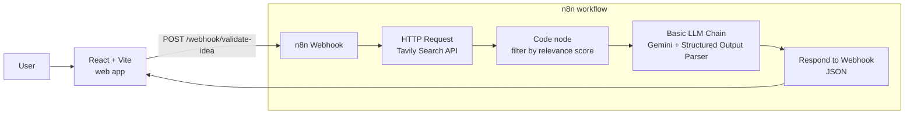

# AI Business Idea Validator

[](https://doi.org/10.5281/zenodo.24162892)

> Validate a startup idea in 30 seconds: real competitors from the web, SWOT, Lean Canvas, risks and a viability score — powered by an **n8n** AI workflow and a **React** dashboard.

**Live demo:** https://tlukashiv-dotcom.github.io/ai-idea-validator/ _(demo mode with real saved reports)_ · **Stack:** n8n · Google Gemini · Tavily Search · React + Vite


https://github.com/user-attachments/assets/0d0954b2-788b-4f9c-beb4-6fcc6865b209


## What it does

Enter a business idea and a target market — the assistant:

- 🔎 **Searches the web** (Tavily) for real competitors and market signals
- 🧠 **Analyzes the idea** with Google Gemini using a strict JSON schema
- 📊 Returns a **viability score (0–100)** with a verdict
- 🏢 Lists **competitors** with links to their websites
- 🧩 Builds a **SWOT analysis** and a full **Lean Canvas** (9 blocks)
- ⚠️ Rates **risks** (high / medium / low) with mitigation ideas
- ✅ Suggests concrete **next steps** to validate the idea
- 🔗 Shows the **sources** the analysis is grounded on

## Architecture



**Key design decisions**

- **n8n as a backend API** — the whole AI pipeline is a visual workflow exposed through a Webhook, so the frontend is a thin static client.
- **Grounding with web search** — without search, the LLM invents generic competitors; Tavily results are filtered by relevance score (noise removal) before being passed to the model.
- **Structured output** — a JSON schema enforced by the Structured Output Parser keeps the response stable enough to render as a dashboard.
- **Free-tier friendly** — one search call and one LLM call per request.

## Project structure

```
ai-idea-validator/
├── frontend/          # React + Vite web app
│   └── src/
│       ├── api.js         # call to the n8n webhook
│       ├── App.jsx        # form, loading/error states, dashboard layout
│       ├── components.jsx # score ring, SWOT, Lean Canvas, risks, ...
│       ├── examples/      # saved real reports for demo mode
│       └── index.css      # design (light/dark, responsive)
├── .github/workflows/ # GitHub Pages auto-deploy (demo mode)
└── n8n/
    └── idea-validator-workflow.json   # exported n8n workflow
```

## Quick start (demo mode, no API keys)

See the UI with real saved reports in ~2 minutes. Requires **Node.js 20.19+** and Git.

```bash
git clone https://github.com/tlukashiv-dotcom/ai-idea-validator.git
cd ai-idea-validator/frontend
npm install
VITE_DEMO_MODE=true npm run dev
```

Open http://localhost:5173 and click one of the sample reports.

## Run the full app locally (live AI analysis)

### Prerequisites

- [Docker](https://www.docker.com/products/docker-desktop/) (for n8n)
- [Node.js](https://nodejs.org/) 20.19+ (for the frontend)
- Free API keys:
  - **Google Gemini** — [Google AI Studio](https://aistudio.google.com/apikey)
  - **Tavily Search** — [tavily.com](https://tavily.com) (1,000 free searches/month)

### 1. Start n8n

```bash
docker volume create n8n_data
docker run -it --rm --name n8n -p 5678:5678 -v n8n_data:/home/node/.n8n docker.n8n.io/n8nio/n8n
```

Open http://localhost:5678 and create the owner account (local only).

### 2. Import the workflow

**Create Workflow** → **⋯** menu (next to the workflow name) → **Import from file** → select `n8n/idea-validator-workflow.json`.

### 3. Connect your own API keys

The exported workflow contains **no credentials** — after import, the nodes that need keys show a warning. Open each one and create a credential:

| Node | Credential type | Value |
|---|---|---|
| **HTTP Request** (Tavily) | Generic Credential Type → **Header Auth** | Name: `Authorization`, Value: `Bearer tvly-YOUR_KEY` |
| **Google Gemini Chat Model** | Google Gemini (PaLM) API | your Gemini API key; then pick a model from the list (e.g. `gemini-2.5-flash`) |

### 4. Enable CORS and publish

1. Open the **Webhook** node → **Options** → **Allowed Origins (CORS)** → `*` for local development (or your frontend URL).
2. Save and click **Publish**.

Test the API:

```bash
curl -X POST http://localhost:5678/webhook/validate-idea \
  -H "Content-Type: application/json" \
  -d '{"idea":"Coffee subscription service for offices","market":"Ukraine"}'
```

### 5. Start the frontend

```bash
cd frontend
npm install
npm run dev
```

Open http://localhost:5173, describe an idea and click **Validate idea** (analysis takes ~20–40 s).

By default the app calls `http://localhost:5678/webhook/validate-idea`. To use another n8n host:

```bash
# frontend/.env
VITE_API_URL=https://your-n8n-host/webhook/validate-idea
```

### Troubleshooting

| Problem | Fix |
|---|---|
| `Could not reach the server` in the UI | n8n is not running, the workflow is not published, or CORS is not enabled in the Webhook node |
| `webhook "validate-idea" is not registered` (404) | Click **Publish** in n8n (production URL works only for published workflows) |
| Gemini error `resource could not be found` | Select the model **from the list** in the Gemini node instead of typing its name |
| Gemini `429 / quota exceeded` | Free tier rate limit — wait a minute or use `gemini-2.5-flash-lite` |

## API

`POST /webhook/validate-idea`

```json
{ "idea": "Coffee subscription service for offices", "market": "Ukraine" }
```

Response (shortened):

```json
{
  "summary": "...",
  "score": 65,
  "verdict": "Needs work",
  "competitors": [{ "name": "...", "description": "...", "url": "https://..." }],
  "swot": { "strengths": [], "weaknesses": [], "opportunities": [], "threats": [] },
  "lean_canvas": { "problem": "...", "customer_segments": "...", "...": "..." },
  "risks": [{ "risk": "...", "level": "high", "mitigation": "..." }],
  "next_steps": ["..."],
  "sources": [{ "title": "...", "url": "...", "content": "..." }]
}
```

## Roadmap

- [ ] Search in the language of the target market
- [ ] Export report to PDF
- [x] Static demo on GitHub Pages (saved real reports, auto-deploy via GitHub Actions)
- [ ] Cloud deployment of the n8n backend
- [ ] Rate limiting / simple abuse protection

## Citation

If you use this project, please cite it:

> Lukashiv, T., & Knignitska, T. (2026). *AI Business Idea Validator* (v1.0.0) [Computer software]. Zenodo. https://doi.org/10.5281/zenodo.24162892

GitHub also offers a ready-made citation via **Cite this repository** (from `CITATION.cff`).

## Authors

- **Taras Lukashiv** · [GitHub](https://github.com/tlukashiv-dotcom) · [LinkedIn](https://www.linkedin.com/in/taras-lukashiv/) · [ORCID](https://orcid.org/0000-0002-1651-6402)
- **Tetiana Knignitska** · [LinkedIn](https://www.linkedin.com/in/tetiana-knignitska-341a47207/) · [Google Scholar](https://scholar.google.com/citations?user=qY8nhzoAAAAJ)

## License

MIT
