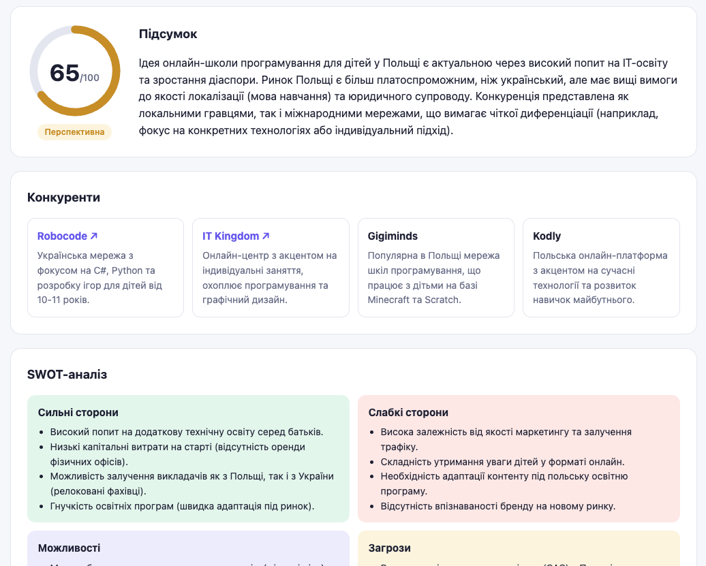
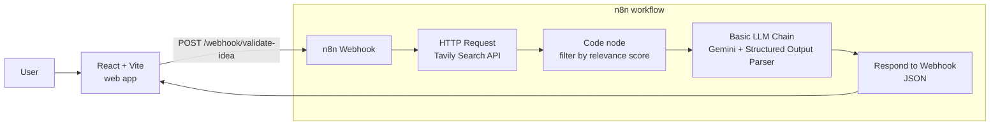

# AI Business Idea Validator

> Validate a startup idea in 30 seconds: real competitors from the web, SWOT, Lean Canvas, risks and a viability score — powered by an **n8n** AI workflow and a **React** dashboard.

**Live demo:** https://tlukashiv-dotcom.github.io/ai-idea-validator/ _(demo mode with real saved reports)_ · **Stack:** n8n · Google Gemini · Tavily Search · React + Vite



## What it does

Enter a business idea and a target market — the assistant:

- 🔎 **Searches the web** (Tavily) for real competitors and market signals
- 🧠 **Analyzes the idea** with Google Gemini using a strict JSON schema
- 📊 Returns a **viability score (0–100)** with a verdict
- 🏢 Lists **competitors** with links to their websites
- 🧩 Builds a **SWOT analysis** and a full **Lean Canvas** (9 blocks)
- ⚠️ Rates **risks** (high / medium / low) with mitigation ideas
- ✅ Suggests concrete **next steps** to validate the idea
- 🔗 Shows the **sources** the analysis is grounded on

## Architecture



**Key design decisions**

- **n8n as a backend API** — the whole AI pipeline is a visual workflow exposed through a Webhook, so the frontend is a thin static client.
- **Grounding with web search** — without search, the LLM invents generic competitors; Tavily results are filtered by relevance score (noise removal) before being passed to the model.
- **Structured output** — a JSON schema enforced by the Structured Output Parser keeps the response stable enough to render as a dashboard.
- **Free-tier friendly** — one search call and one LLM call per request.

## Project structure

```
ai-idea-validator/
├── frontend/          # React + Vite web app
│   └── src/
│       ├── api.js         # call to the n8n webhook
│       ├── App.jsx        # form, loading/error states, dashboard layout
│       ├── components.jsx # score ring, SWOT, Lean Canvas, risks, ...
│       ├── examples/      # saved real reports for demo mode
│       └── index.css      # design (light/dark, responsive)
├── .github/workflows/ # GitHub Pages auto-deploy (demo mode)
└── n8n/
    └── idea-validator-workflow.json   # exported n8n workflow
```

## Run locally

### 1. n8n backend

```bash
docker volume create n8n_data
docker run -it --rm --name n8n -p 5678:5678 -v n8n_data:/home/node/.n8n docker.n8n.io/n8nio/n8n
```

1. Open http://localhost:5678 → **Import from file** → `n8n/idea-validator-workflow.json`.
2. Create credentials:
   - **Google Gemini (PaLM) API** — free key from [Google AI Studio](https://aistudio.google.com/apikey)
   - **Header Auth** for Tavily — `Authorization: Bearer tvly-...` (free key at [tavily.com](https://tavily.com))
3. In the **Webhook** node set *Allowed Origins (CORS)* to your frontend URL (or `*` for local dev).
4. **Publish** the workflow.

### 2. Frontend

```bash
cd frontend
npm install
npm run dev
```

Open http://localhost:5173. To run the static demo mode (saved reports, no backend): `VITE_DEMO_MODE=true npm run dev`.

By default the app calls `http://localhost:5678/webhook/validate-idea`; override it with an env variable:

```bash
# frontend/.env
VITE_API_URL=https://your-n8n-host/webhook/validate-idea
```

## API

`POST /webhook/validate-idea`

```json
{ "idea": "Coffee subscription service for offices", "market": "Ukraine" }
```

Response (shortened):

```json
{
  "summary": "...",
  "score": 65,
  "verdict": "Needs work",
  "competitors": [{ "name": "...", "description": "...", "url": "https://..." }],
  "swot": { "strengths": [], "weaknesses": [], "opportunities": [], "threats": [] },
  "lean_canvas": { "problem": "...", "customer_segments": "...", "...": "..." },
  "risks": [{ "risk": "...", "level": "high", "mitigation": "..." }],
  "next_steps": ["..."],
  "sources": [{ "title": "...", "url": "...", "content": "..." }]
}
```

## Roadmap

- [ ] Search in the language of the target market
- [ ] Export report to PDF
- [x] Static demo on GitHub Pages (saved real reports, auto-deploy via GitHub Actions)
- [ ] Cloud deployment of the n8n backend
- [ ] Rate limiting / simple abuse protection

## Author

**Taras Lukashiv** — built as a hands-on project to learn AI automation with n8n.

## License

MIT
